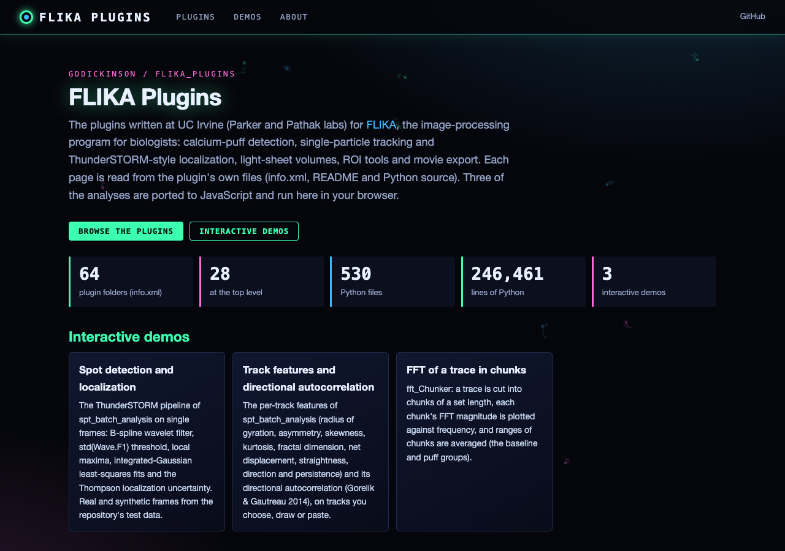
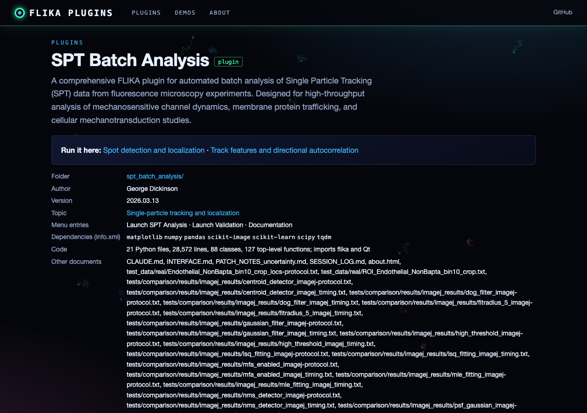
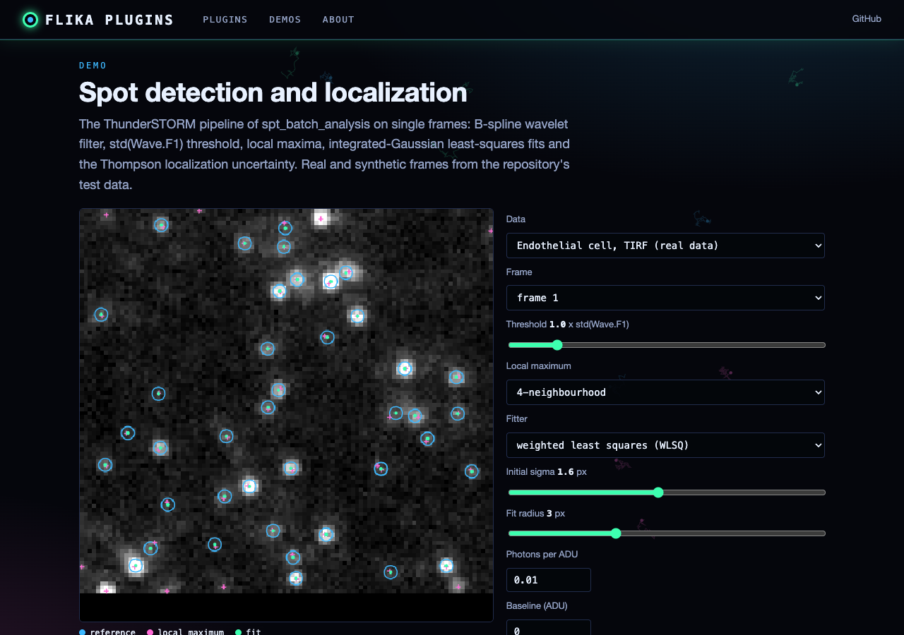
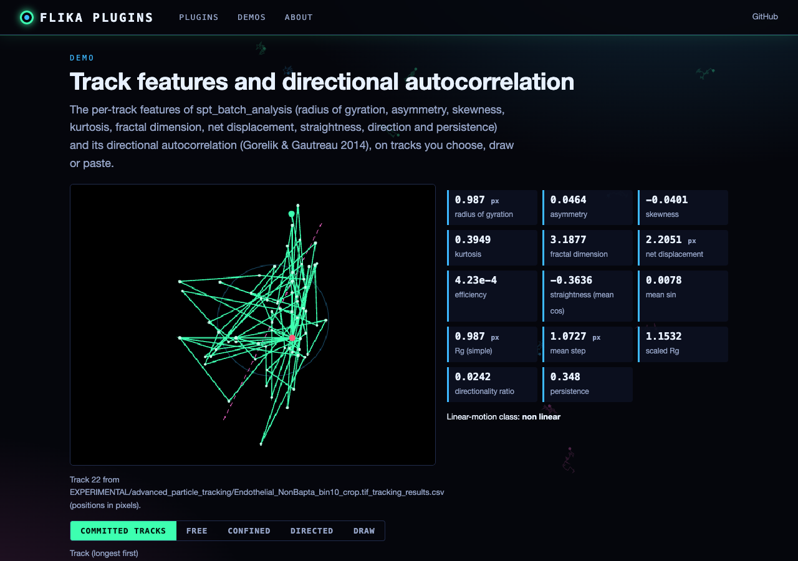

# FLIKA Plugins Collection

A collection of Python plugins developed at UCI to extend [FLIKA](https://github.com/flika-org/flika), an interactive image processing program for biologists.

## Overview

These plugins were developed for research at:
- [Parker Lab](https://parkerlab.bio.uci.edu/)
- [Pathak Lab](https://www.pathaklab-uci.com/)

## Installation

1. Download the desired plugin folder
2. Move it to your `~/.FLIKA/plugins` directory
3. Restart FLIKA
4. The plugin will appear in FLIKA's plugins menu

For detailed plugin installation instructions, visit the [FLIKA documentation](http://flika-org.github.io/plugins.html).

## Plugins

### Image Analysis
- **annotator** - Add annotations to image stacks
- **detect_puffs** - Calcium puff detection and analysis (top level as `detect_puffs_GDedit`; the original is in `NOT_WORKING_WITH_PY311/` and `OLD/`)
- **dipoleAnalysis** - Analysis tools for dipole images (in `NOT_WORKING_WITH_PY311/`)
- **fft_Chunker** - FFT analysis on time-series data
- **openCV** - OpenCV-based image processing tools
- **overlay** - Image overlay and comparison tools

### ROI Tools
- **centerSurroundROI** - Create linked center and surround ROIs
- **roiExtras** - Additional ROI analysis capabilities
- **linescan** - Line scan analysis tools

### File Management & Loading
- **fileLoader** - Extended file format support including ND2 (in `NOT_WORKING/`)
- **lightSheet_tiffLoader** - Specialized light sheet TIFF loading
- **packageManager** - Plugin and dependency management (in `EXPERIMENTAL/`)

### Specialized Analysis
- **pynsight** - Single molecule localization (top level as `pynsight_GDedit`; the original is in `NOT_WORKING_WITH_PY311/` and `OLD/`)
- **quantimus** - Quantitative image analysis (in `OLD/`)
- **rodentTracker** - Animal tracking and behavior analysis (in `OLD/`)
- **locsAndTracksPlotter** - Particle tracking visualization and analysis
  - Compatible with:
    - pynsight
    - [thunderStorm](https://zitmen.github.io/thunderstorm/)
    - [trackpy](http://soft-matter.github.io/trackpy/v0.6.1/)

### Light Sheet Tools
- **light_sheet_analyzer** - Light sheet microscopy analysis (top level as `light_sheet_analyzer_GDedit`)
- **onTheFly_Reconstruction** - Real-time image reconstruction (in `NOT_WORKING/`)

### Simulation
- **simulateMEPP** - Miniature end-plate potential simulation (in `OLD/` as `mepp_simulator`)
- **simulatePuff** - Calcium puff simulation

### Data Analysis
- **GlobalAnalysisPlugin** - Global data analysis tools (in `EXPERIMENTAL/`)
- **puffMapper** - Spatial analysis of calcium puffs (in `EXPERIMENTAL/`)
- **scaledAverageSubtract** - Background subtraction tools
- **synapse_plugin** - Synaptic activity analysis (in `NOT_WORKING/`)
- **volumeSlider** - 3D volume visualization and analysis

### Specialized Applications
- **neuroLab_207** - Neuroscience lab-specific tools (in `OLD/`)

The list above is not complete: the web catalogue below lists all 64 plugin folders (those with an `info.xml`),
including the newer ones (spt_batch_analysis, thunderstorm_flika, kymograph_analyzer, flash_remover, ...) and the
`EXPERIMENTAL/`, `NOT_WORKING/`, `NOT_WORKING_WITH_PY311/`, `OLD/` and `backups/` folders.

## Web catalogue and demos

A browsable catalogue of every plugin, read from the repository itself (info.xml, README, and each Python file parsed
with `ast`), with interactive demos of three pure-numpy analyses ported to JavaScript and run in the browser:

- **Spot detection and localization**: the `spt_batch_analysis/thunderstorm_python` pipeline on single frames
  (B-spline wavelet filter, `std(Wave.F1)` threshold, 4/8-neighbourhood local maxima, integrated-Gaussian LSQ/WLSQ fits,
  Thompson uncertainty) on a real TIRF frame from `test_data/real` (compared with the ImageJ ThunderSTORM localizations
  committed beside it) and synthetic frames with ground truth.
- **Track features and directional autocorrelation**: `FeatureCalculator`, `GeometricAnalyzer`, `DirectionAnalyzer`
  and `AutocorrelationAnalyzer` from `spt_batch_analysis` on committed tracks, random walks, drawn or pasted tracks.
- **FFT in chunks**: `fft_Chunker`'s `fft_chunks` and group averages on the plugin's own test signal or a pasted trace.

Each port is checked in node against the plugin's own Python (`tests/fixtures/demo_cases.json`, written by
`scripts/make_demo_fixture.py`); the localization port reproduces the Python fits to better than 1e-6.
Not ported: U-Track linking, the SVM classifier, MLE and multi-emitter fitting, puff detection, light-sheet
reshaping and the deep-learning plugins (they need FLIKA, Qt or large libraries).

Static site: https://gddickinson.github.io/flika_plugins/ (built by `.github/workflows/pages.yml`).

Run it locally:

```sh
pip install -r requirements-web.txt
python run_web.py             # http://127.0.0.1:8198
python -m pytest -q tests     # catalogue, demos, fixture, regression tests and the node tests of the JS ports
```

| | |
|---|---|
|  |  |
|  |  |

## Contributing

Contributions are welcome! Please feel free to submit a Pull Request.

## License

This project is licensed under the MIT License - see the [LICENSE](LICENSE) file for details.

## Authors

### Primary Contributors
- George Dickinson
- Kyle Ellefsen
- Brett Settle

### Acknowledgments
Several plugins were adapted or extended from original code by Kyle Ellefsen and Brett Settle.

## Support

For issues specific to these plugins, please use the GitHub issues system.
For general FLIKA support, visit the [FLIKA documentation](http://flika-org.github.io/).

## Version History

Updates and changes are tracked in individual plugin directories.

## Citing

If you use these plugins in your research, please cite both FLIKA and the specific plugin used.

## Contact

- **George Dickinson**
- Institution: University of California, Irvine
- Lab: Ian Parker Lab, McGaugh Hall
- Date: August 23, 2020

---
*Note: Each plugin directory contains detailed documentation specific to that tool.*